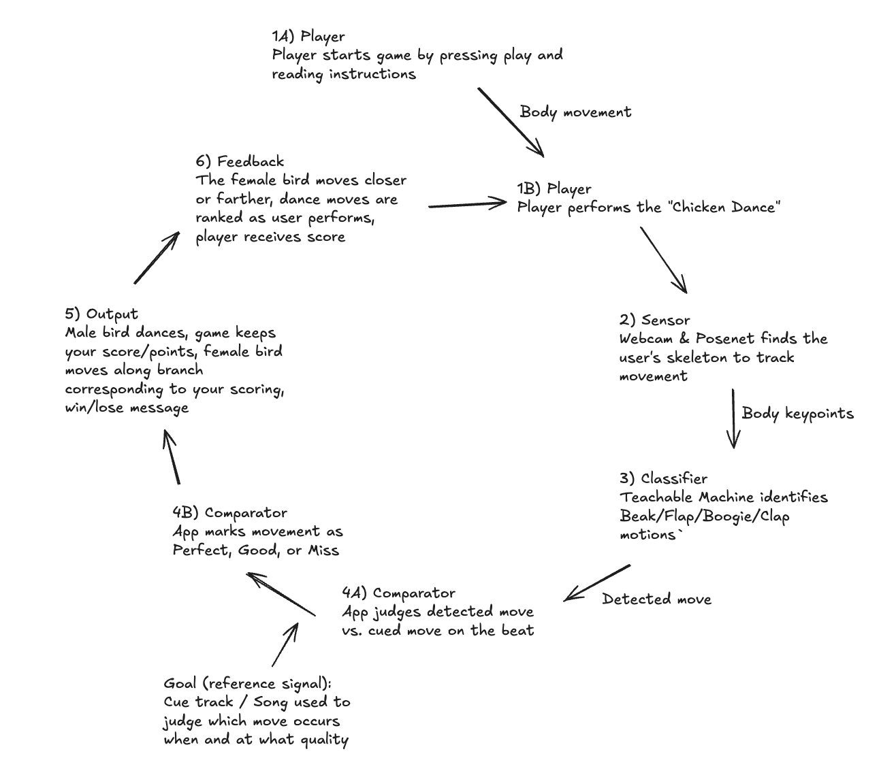

# Clearing Dance

**Live site:** https://lab-5-bird-dance-fg1xtb-7acb1e-67-159-76-228.sslip.io

**Cybernetic loop diagram:** [diagram/cybernetic-loop.png](diagram/cybernetic-loop.png) (editable source: [diagram/cybernetic-loop.excalidraw](diagram/cybernetic-loop.excalidraw), open it at excalidraw.com)

A webcam dance game built with TensorFlow.js and Teachable Machine. You are a male Western parotia performing a courtship display in a forest clearing, and a female watches from the branch above. A pose model recognizes your moves to the chicken dance. When you dance well she walks closer along the branch, and when you miss she backs away.

## Biomimicry

Male Western parotias clear a patch of the forest floor and perform a precise "ballerina dance" there, spreading their feathers into a skirt and waggling their head plumes. Females watch from a perch above and choose based on the performance. The game copies that setup:

- **The display:** the chicken dance moves (Beak, Flap, Boogie, Clap), each mapped to a parotia movement: head waggle, wing flap, skirt sway and wing sweep.
- **The judge:** the female moves along the branch toward you or away from you, facing the way she walks. That movement is the feedback signal.
- **Plumage:** the male glows brighter as your combo grows.

## How it works

1. The webcam feeds **PoseNet** (through `@teachablemachine/pose`), which finds your body.
2. A **Teachable Machine** classifier trained on five classes (Beak, Flap, Boogie, Clap, Idle) labels each frame.
3. The song runs at 94 BPM. Each verse cues 16 moves, 2 beats each, along the bottom of the screen, and the choruses are free-dance breaks.
4. A move counts if the model detects it with at least 70% confidence for enough of its window: 50% of frames for PERFECT, 20% for GOOD.
5. The male parotia mirrors whatever the model detects, so you can see what it sees.
6. The game is a tug of war. Her interest sets where she stands on the branch, and she starts in the middle (50%).
   - Each move pulls her closer or pushes her away: PERFECT about +8.3, GOOD about +4.2, MISS about −4.2.
   - **6 perfects** (or 12 goods) bring her all the way down to you, and you win.
   - **12 misses** push her away completely, and you lose.
   - Successes pull harder than misses push because players miss more often than they hit.
   - The game ends as soon as she reaches either end. If the song runs out first, you win if she's closer than where she started.

## Run locally

The model files have to be served over HTTP, and camera access needs `localhost` or HTTPS.

1. Open this folder in VS Code.
2. Right-click `index.html` and choose **Open with Live Server**.
3. Press **Play**, allow camera access, and step back so your head, arms and waist are in the camera box.

Add `?debug` to the URL to show the model's live confidence for each class and the song's beat counter.

## Files

- `index.html`: scene, bird rig, leaf curtains
- `style.css`: layout, dance animations, curtain transitions
- `game.js`: model and webcam loop, song timeline, scoring, female movement
- `model/`: the Teachable Machine pose model export
- `assets/`: forest background, leaf, female, male parts (head, body, legs, spread and raised wings) and the song

## Tuning

The constants at the top of `game.js` control timing and difficulty. If the cued moves are out of step with the song, change `MOVE_OFFSET` (0–3) or `FIRST_BEAT`. For difficulty, adjust `PERFECTS_TO_WIN`, `MISSES_TO_LOSE` and `START_INTEREST` (the tug of war), or `CONFIDENCE`, `PERFECT_RATIO` and `GOOD_RATIO` (how strictly each move is judged).
